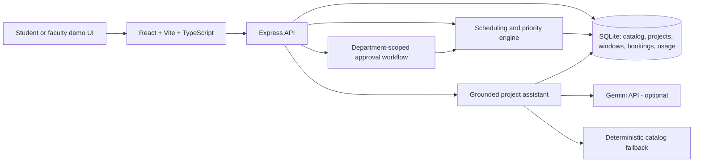
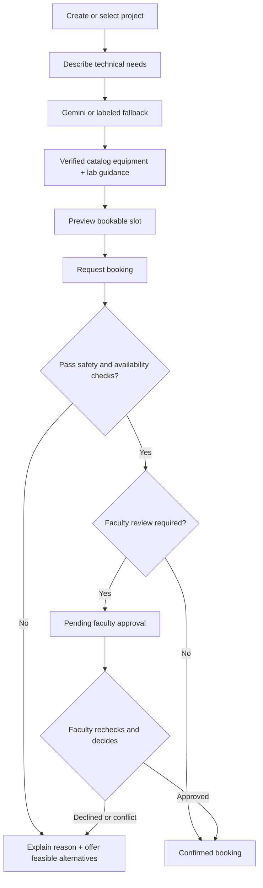

LabLink — Smarter Access to Campus Laboratories
PromptWars × Cynergy 2026 | Education & Campus Laboratory Resource Sharing
Discover equipment. Describe your project. Reserve fair lab time. Get faculty approval.

LabLink is a full-stack campus laboratory resource-sharing prototype that connects students to equipment and workstations across departments. Students can browse real catalog records, create projects, request time slots, and receive explainable alternatives when resources are contested. Faculty review department-specific requests. A Gemini-powered project assistant helps translate natural-language project needs into verified catalog recommendations, while a separate deterministic scheduler makes auditable, fair, constraint-safe booking decisions.

What makes LabLink different: it does not let an LLM invent equipment or make unreviewable access decisions. Generative AI interprets the project's technical needs; the scheduling engine enforces lab hours, deadlines, maintenance, reservations, eligibility, priority, and faculty approval.
1. Evaluation quick start
Requirements: Node.js 22.13+ (Node 22 LTS recommended), npm, and a modern web browser. No cloud database, paid AI key, or external service is required for the core demo.
npm install
npm run dev
- Open http://127.0.0.1:5173 to use the app. The Express API runs at http://127.0.0.1:3001 and Vite proxies /api.
- On first launch, the backend initializes and seeds data/lablink.sqlite with fictional campus users, projects, equipment, lab windows, and booking requests. Data is persistent between launches.
- The default account is a student demo account (Ananya Rao). Use the account selector in the application to switch to the relevant faculty demo account, including Dr. Meera Iyer (ECE).
- No Gemini key? The Project Assistant still works using a clearly labeled catalog keyword-matching fallback. See Optional Gemini setup for genuine model-based recommendations.
Judge walkthrough (approximately 3–5 minutes):
1. Discover: Open Explore Equipment; search for ESP32, FPGA, or oscilloscope. Filter by department, category, or availability; inspect specifications, lab location, and whether faculty permission is needed.
2. Create a project: In Project Assistant → Your projects → Create a project, register a project with a title, description, future deadline (IST), and optional required equipment. The project becomes selectable in the existing booking flow.
3. Get project guidance: Describe a technical goal such as “Build an ESP32 air-quality monitor and inspect sensor waveforms.” View grounded recommendations, supporting catalog facts, and the next feasible 30-minute slot; use Book this time to open a prefilled booking form. Without an API key, the deterministic fallback is labeled visibly.
4. See conflict handling: Select a valid project and try requesting the Digital Oscilloscope during an already confirmed demo reservation (the seeded reservation is on the second scheduled lab day, 10:00–11:00 IST). LabLink explains the conflict and offers feasible alternatives when available. The exact calendar date depends on when the demo database was first seeded.
5. Review faculty workflow: Switch to Dr. Meera Iyer and open Faculty Approvals to review pending ECE requests, including the seeded FPGA requests. Approve or decline an eligible request; switch back to the student to see its updated status. Decisions remain subject to the live availability and fairness checks.
Demo-data note: Seeded lab windows and future dates are relative to the first database initialization, not refreshed on every start. If an old demo database has past dates, use a new, separate database path for a fresh walkthrough rather than deleting or overwriting data you need to preserve.

2. Challenge alignment — requirement to implementation
PromptWars requirement	What LabLink implements	Where to verify
Cross-department equipment discovery	Searchable, filterable catalog with specs, department, location, status, and approval requirements for ECE, CSE, and Mechanical labs	client/src/pages/Explore.tsx, server/resources.mjs, server/seed.mjs
GenAI-powered project guidance	Natural-language project-to-equipment matching; grounded Gemini selections; clarifying questions; validated catalog IDs and source facts	client/src/pages/ProjectAssistant.tsx, server/assistant.mjs, server/gemini.mjs
Project-based access requests	Students create owned projects with deadlines and equipment requirements, then select them for recommendations and bookings	server/app.mjs, server/schema.sql, client/src/pages/ProjectAssistant.tsx
Intelligent slot booking	Time and eligibility validation; lab-hour, deadline, maintenance, and confirmed-reservation checks; alternative suggestions and rescheduling	server/scheduling.mjs, client/src/pages/EquipmentBooking.tsx
Fair conflict resolution	Deterministic multi-factor priority with aging, feasibility, deadline slack, required equipment, usage history, and submission-order tie-breaking	server/scheduling.mjs, server/scheduling.test.mjs
Faculty approval	Department-scoped approval queue, pending states, approval/decline decisions, and atomic rechecks to avoid conflicting confirmations	server/approvals.mjs, server/app.mjs
Responsible resource utilisation	Availability-aware recommendations and fair-share checks against the last 30 days of equipment use	server/scheduling.mjs, server/assistant.mjs
Accessibility & reliability	Labeled inputs, keyboard navigation, mobile layouts, explicit loading/error/status messages, automated backend and integration tests	client/src/App.tsx, client/src/styles.css, server/*.test.mjs

Design principle: The AI suggests which catalog equipment fits the project; the rules engine determines whether and when it may be booked. The model cannot authorize faculty decisions or bypass resource constraints.
3. Architecture and decision flow

- Frontend: React, TypeScript, Vite, Tailwind CSS; reusable equipment and status components and responsive student/faculty views.
- Backend: Node.js 22, Express 5; validation and access checks on the server, not only in the UI.
- Persistence: Native node:sqlite with SQLite STRICT tables, constraints, indexes, and transactional writes.
- AI integration: Backend-only Gemini API client with constrained JSON output, server-side catalog validation, retry and quota protection, and deterministic fallback.
- Clock and scheduling: API timestamps include explicit offsets; lab and demo times are presented in Asia/Kolkata (IST).
End-to-end student journey

4. Fair scheduling — transparent rules, not a black-box LLM
LabLink's deterministic, explainable allocation engine is in [`server/scheduling.mjs`](server/scheduling.mjs). It checks hard constraints before it considers relative priority.

Hard constraints (must all hold): the resource exists and is available; the student owns the project; the request is in the future; its duration is 15 minutes to 8 hours; it fits completely within an open lab window; it ends before the project's deadline; it does not overlap maintenance; and it does not conflict with confirmed equipment or student reservations. Time intervals are half-open, so a session may start exactly when another ends.

For feasible competing requests, the priority rules are applied in order:
1. Anti-starvation: requests that have waited at least 48 hours receive precedence, with earlier submission order resolving ties in this aged group.
2. Flexibility: prioritize the request that cannot feasibly move to another suitable slot.
3. Deadline slack: prioritize the project with less remaining time to complete the requested session before its deadline.
4. Declared equipment requirement: prefer projects that explicitly list the requested equipment as required.
5. Fair-share history: prefer the student with fewer minutes of recent usage of that resource over the previous 30 days.
6. Stable tie-breaker: earlier submission order wins when the preceding factors are equal.
These are ordered comparison rules, not a hidden AI score or an arbitrary weighted sum. The application communicates why a request is outranked. Feasible alternative times are generated against open lab windows, maintenance, confirmed bookings, other relevant requests, and deadline constraints.

Illustrative conflict (not a claim about a specific seeded request):
Condition	Student A	Student B
Requested equipment and time	Same FPGA board, overlapping slot	Same FPGA board, overlapping slot
Request age	Under 48 hours	Under 48 hours
Other feasible slots	Equally constrained	Equally constrained
Project deadline	Sooner	Later
Result, if all earlier rules tie	Ranked ahead on deadline slack	Offered another feasible slot if one exists

No pending request is treated as a confirmed reservation. A faculty approval rechecks the current slot, priority, and eligibility inside a BEGIN IMMEDIATE SQLite write transaction before confirmation. This protects against stale decisions and competing approvals producing double bookings. The seeded FPGA requests and server/scheduling.test.mjs provide evidence for the actual priority and approval paths.
5. Project creation and faculty decisions
In the current student workflow, Project Assistant → Your projects → Create a project accepts a title, description, future deadline in IST, and optional required catalog equipment. The backend validates these fields, checks catalog identifiers, takes project ownership from the selected demo student identity rather than a caller-supplied owner ID, and writes the project and requirements in one transaction. Newly created projects appear in the booking selector. The API tests check invalid input, unauthorized faculty creation, owner spoofing, and deadline-aware bookings.

Equipment that requires faculty approval remains pending until an eligible faculty member makes a decision. Faculty queues are scoped to their department; final approval runs the scheduling checks again. Students can review decisions in My Bookings and reschedule pending requests using suggested alternatives.
6. GenAI: grounded, optional, and credit-aware
LabLink uses Gemini for interpreting unstructured project descriptions, not for overriding availability or approval policies.
1. The server assembles a compact factual catalog from SQLite and submits it with the student's description to the model.
2. Gemini returns constrained structured data: known resource IDs, indexes into the catalog's fact list, exact supporting excerpts from the project description, and optional clarification-question codes.
3. Server-side validation rejects unknown IDs, invalid fact indexes, duplicated or malformed entries, and evidence not present in the original description.
4. The server adds catalog facts and fresh scheduling availability to validated recommendations; the interface shows the next bookable 30-minute slot and a prefilled booking action.
5. If the model is unavailable, misconfigured, over budget, times out, or returns unverifiable output, the UI explicitly labels keyword-matching fallback rather than presenting it as Gemini output.
Controls that protect API credits: configurable daily upstream-attempt cap (default 20, including retries), per-account rolling-minute limit (four attempts), short request timeout, at most one retry for transient failures, SHA-256-keyed in-memory recommendation cache (10-minute TTL), in-flight request coalescing, and database-backed usage accounting that resets at midnight IST. Cached recommendations do not bypass the fresh availability check.

Security boundary: only the backend holds the API key. Model output cannot insert new equipment, authorize bookings, change priority, or replace permission checks. The application treats student descriptions and catalog content as data, not executable instructions.
7. Optional Gemini setup and credit controls
The basic app and all core booking features run without Gemini credentials.
cp .env.example .env
Edit the local, Git-ignored .env file. Never commit a real API key or paste it into an issue.
PORT=3001
LABLINK_DB_PATH=data/lablink.sqlite
GEMINI_API_KEY=YOUR_KEY_HERE
GEMINI_MODEL=gemini-3.1-flash-lite
GEMINI_DAILY_REQUEST_CAP=20
GEMINI_ENABLE_IN_DEV=false
GEMINI_DIAGNOSTICS=false
- npm start uses the configured backend key after npm run build.
- npm run dev intentionally blocks real Gemini calls unless GEMINI_ENABLE_IN_DEV=true is explicitly set for controlled local testing.
- Set GEMINI_DAILY_REQUEST_CAP=0 for fallback-only mode. The cap is an app-level safety control, not a provider billing limit.
- GEMINI_DIAGNOSTICS=true enables sanitized failure categories for local troubleshooting, without exposing keys or request bodies.
- Restart the server after changing .env. Automated tests use mocked provider responses and do not make paid inference calls.
8. API reference
All account-scoped endpoints use the x-lablink-demo-account header with a fictional ID from /api/demo-accounts. This is demo-only account selection, not authentication.
Method	Endpoint	Purpose
GET	/api/health	Basic local service health
GET	/api/demo-accounts	Available fictional student and faculty identities
GET	/api/resources	Catalog; q, department, category, status filters
GET	/api/resources/:id	Details, specifications, lab windows, status
GET	/api/projects	Projects owned by the selected demo account
POST	/api/projects	Create a student project with deadline and validated optional equipment requirements
GET	/api/bookings	Student's requests, statuses, and scheduling guidance
POST	/api/bookings	Request a session; supports pending-request replacement for rescheduling
GET	/api/approvals	Department-scoped faculty review queue
POST	/api/approvals/:id	Faculty approved or declined decision
GET	/api/assistant/status	Assistant availability/configuration status without exposing secrets
POST	/api/assistant/recommendations	Grounded project-to-equipment recommendations and fresh slot previews

Booking request fields: resourceId, projectId, startsAt, endsAt, and purpose, with optional replaceRequestId for changing a pending request. Timestamps must include a timezone offset. Invalid inputs and access failures are rejected by the backend.

Access limitation: identity switching via x-lablink-demo-account is intentionally unrestricted for the local demo. Do not expose this prototype as a multi-user public service without proper authentication, secure sessions, CSRF protections as applicable, and deployment hardening.
9. Testing and verification
npm run check     # TypeScript + server syntax
npm test          # Node.js tests for API, persistence, scheduling and AI
npm run build     # Type check + Vite production bundle
npm start         # Run built frontend and API on http://127.0.0.1:3001
Latest locally reported milestone: 24 passing automated tests, TypeScript/syntax checks passed, and production Vite build passed after adding project creation. The new API test covers malformed project creation, faculty rejection, ownership spoofing, and booking/deadline integration. Earlier quality checks also reported headless browser coverage of filtering, recommendation-to-booking, faculty review, keyboard interactions, and responsive widths. These are development/test reports, not independently certified production benchmarks.

Important cases exercised by automated tests include:
- Catalog filters and SQL-backed lookup; invalid input and account permissions.
- Booking duration, timezone, lab hours, project deadlines, maintenance, overlaps, and alternatives.
- Competing submissions and competing faculty approvals, with a transaction recheck.
- Each fairness factor and the anti-starvation/tie-breaking rules.
- Catalog-grounded Gemini data validation, malformed-model fallback, rate/daily caps, caching, retries, and timeouts; mocked AI HTTP traffic only in the automated suite.
- Student project creation validation and ownership protections.
Manual verification: a real Gemini recommendation was observed in development under the label “Gemini recommendations”. The newly added Create a project form has passed build/API checks; its end-to-end browser interaction should be manually exercised before submission. Availability examples depend on the seeded database state.
10. Repository map
client/
  src/App.tsx                 Student/faculty navigation and demo identity selector
  src/pages/                 Explore, details, bookings, approvals, assistant
  src/styles.css              Responsive styles and accessibility polish
server/
  app.mjs                     Express endpoints and request validation
  assistant.mjs               Grounded recommendations, caching and quota controls
  gemini.mjs                  Backend-only Gemini provider and diagnostics
  scheduling.mjs              Validation, alternative slots and fairness ranking
  approvals.mjs               Faculty review and atomic approval rechecks
  resources.mjs               SQLite equipment search and details
  database.mjs                SQLite connection and initialization
  schema.sql                  STRICT tables, constraints and indexes
  seed.mjs                    Fictional catalog, users, projects and booking fixtures
  *.test.mjs                  Automated domain, integration and failure-mode tests
shared/types.ts               Shared client/server data contracts
scripts/dev.mjs               Coordinated local development startup
.env.example                  Safe configuration template (no secrets)
README.md                     Documentation and demo walkthrough
11. Assumptions, scope, and known limitations
- Prototype scope: fictional campus, departments, faculty and resources; not connected to a university's actual inventory, calendar or identity service.
- Authentication: accounts are openly selectable demo personas; server-side ownership and faculty-department checks remain meaningful for the demo but are not cryptographic authentication.
- Inventory operations: catalog, lab windows and maintenance fixtures are seeded in SQLite; there is no general-purpose laboratory admin panel to modify inventory or operating hours.
- Availability: open windows are finite and seeded relative to first initialization; there is no recurring real-university timetable sync.
- AI availability: a real Gemini call needs the operator's own key and network access. Judges without one can demonstrate the honest deterministic fallback and all scheduling workflows.
- Fairness: policy factors are explicit implementation choices, not university-wide entitlement rules. They should be audited and adapted before institutional deployment.
- Hosting: optimized for localhost judging, with frontend and backend served together in production mode; no public production deployment is claimed.
12. Submission and reproducibility checks
PromptWars requires a public GitHub repository, one branch, and a repository below 10 MB. The evaluator permits at most two submission attempts. Before submitting:
git status
git ls-remote --heads origin
git check-ignore .env
git ls-files -z | xargs -0 du -ch | tail -1
git count-objects -vH
npm run check && npm test && npm run build
Confirm that secrets, node_modules, local SQLite files, and build output are not tracked; commit tested source and package-lock.json; push the final main commit; and inspect the public GitHub README. Check the competition's own submission procedure before using either attempt.
LabLink's core claim: Use GenAI to understand what a student needs, use verified catalog data to recommend it, and use transparent scheduling rules to allocate scarce lab resources fairly.

Built for PromptWars × Cynergy 2026 as a local, judgeable engineering prototype.